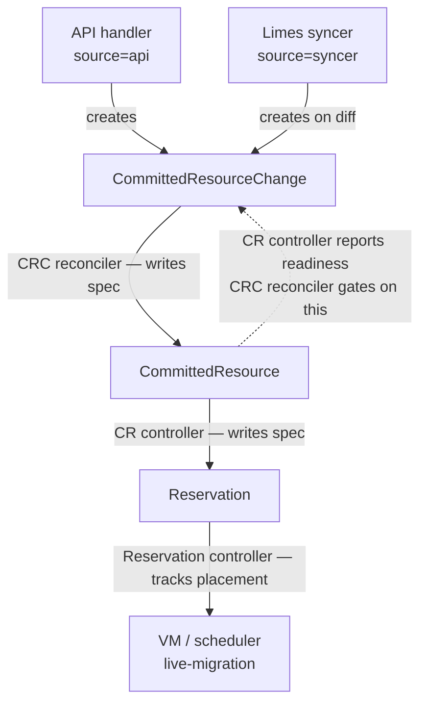
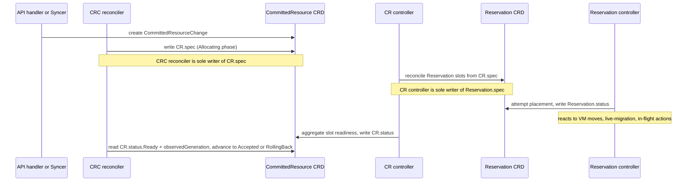
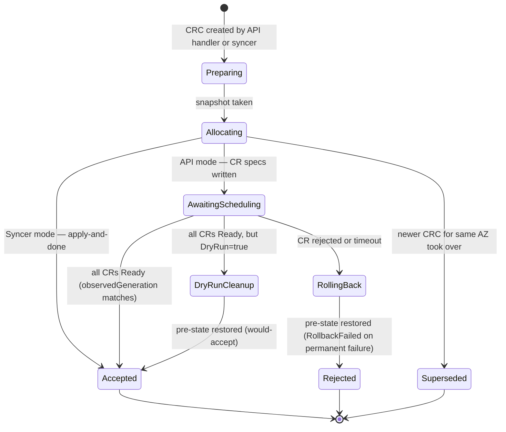

<!--
# SPDX-FileCopyrightText: Copyright SAP SE or an SAP affiliate company and cobaltcore-dev contributors
#
# SPDX-License-Identifier: Apache-2.0
-->

# Committed-resource transaction architecture (target)

## Components

| Component | Kind | Owned by |
|-----------|------|----------|
| `CommittedResourceChange` (CRC) | CRD | Spec: created by API handler or syncer; Status: CRC reconciler |
| `CommittedResource` (CR) | CRD | Spec: CRC reconciler (sole writer); Status: CR controller |
| `Reservation` | CRD | Spec: CR controller (sole writer); Status: Reservation controller |
| Change-commitments API | HTTP handler | Creates CRC with `source=api` |
| Limes syncer | Background poller | Creates CRC with `source=syncer` on each diff |
| CRC reconciler | Controller | Drives CRC FSM; writes CR specs; rolls back on failure |
| CR controller | Controller | Derives Reservation slots from CR spec; reports CR readiness |
| Reservation controller | Controller | Attempts host placement; reports slot readiness |

## Ownership

No controller writes its own spec. Spec flows down; status flows up.

## Component interaction

The three reconcilers operate independently and communicate only through CRD status conditions.

## CRC state machine

Terminal phases (`Accepted`, `Rejected`, `Superseded`) set `Finished=True`. Non-terminal problems set
`Progressing=False` with a reason (`Stalled`, `TimedOut`, `Error`, `RetryExhausted`) without advancing
the phase. A stuck non-terminal CRC triggers an alert; after a threshold it is forcibly moved to
`Superseded` so its AZ is unblocked and the syncer repairs state on the next poll.

## Request flows

### API-mode flow

1. **API handler** receives a change-commitments request from Limes; creates a CRC (`source=api`, `allowRejection=true`, optional `dryRun=true`).
2. **CRC reconciler — Preparing**: validates the request; snapshots current CR specs as the rollback journal.
3. **CRC reconciler — Allocating**: writes the desired CR specs atomically; records which CRs were touched.
4. **CRC reconciler — AwaitingScheduling**: watches the touched CRs; waits until each reports its ready condition against the generation just written.
5. **CR controller**: for each CR, derives and reconciles Reservation slots; reports `Ready` once all slots are placed.
6. **Reservation controller**: places each slot on a host; reports slot readiness.
7. **CRC reconciler**: all CRs ready → `Accepted`; any CR rejected or timeout → rolls all CR specs back to the snapshot → `Rejected`.
8. **API handler** polls the CRC by name; maps terminal phase to HTTP response.

### Syncer-mode flow

1. **Limes syncer** polls Limes per project; diffs desired state against current CRs; on any delta creates a CRC (`source=syncer`, `allowRejection=false`).
2. **CRC reconciler — Preparing**: no snapshot (non-rejectable; syncer repairs on next poll if anything drifts).
3. **CRC reconciler — Allocating**: recency check — skips changes for any project another CRC touched in the same AZ in the last ~10 minutes (prevents clobbering an in-flight API change); writes CR specs; advances directly to `Accepted`.
4. **CR controller**: reconciles Reservation slots async; CRC is already terminal.
5. Slots converge in the background; the next syncer poll repairs any remaining drift.

## Key invariants

- **Single writer per spec layer.** The CRC reconciler is the only component that writes `CommittedResource.spec`. The CR controller is the only component that writes `Reservation.spec`. No controller writes its own spec.
- **AwaitingScheduling gates on generation.** The CRC reconciler advances from `AwaitingScheduling` only when a CR's ready condition carries an `observedGeneration` that matches the generation the CRC reconciler wrote — not an older reconcile cycle's result.
- **Rollback is durable.** The pre-change snapshot is stored in `CRC.status` before any CR spec is touched. A process restart resumes from the persisted phase and snapshot.
- **Syncer-mode never rolls back.** Syncer CRTs are non-rejectable: on any error they retry until `Accepted` or are superseded by a newer CRC. The syncer repairs drift on its next poll.
- **At most one active CRC per AZ.** The CRC reconciler serialises with `MaxConcurrentReconciles=1` plus an in-memory per-AZ active-transaction map (rebuilt from CRDs on startup). Younger CRTs requeue until the active one reaches a terminal phase.
- **Syncer recency guard prevents clobbering.** A syncer CRC skips changes to any project that an API CRC touched in the same AZ within the last ~10 minutes — the API change is authoritative; the syncer will reconcile remaining drift on its next poll.
- **Terminal CRTs are retained for auditability.** `Accepted` CRTs are kept for ~1 hour; `Rejected` CRTs for ~5 days. Non-terminal CRCs (including stuck `RollingBack`) are never GC'd — deleting one loses the rollback journal and the AZ active-marker.

---

[Prev: CR lifecycle internals](03-a-cr-lifecycle-internals.md) · [Next: Failover reservations for KVM HA »](03-failover-reservations.md)
