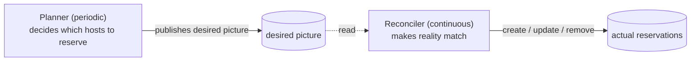
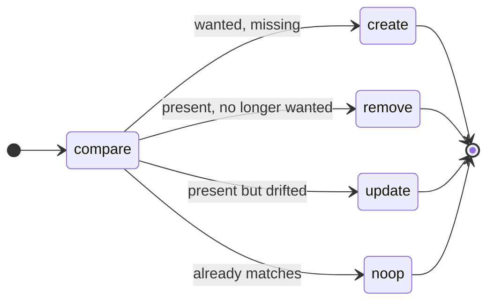
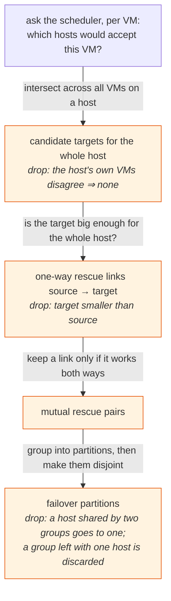
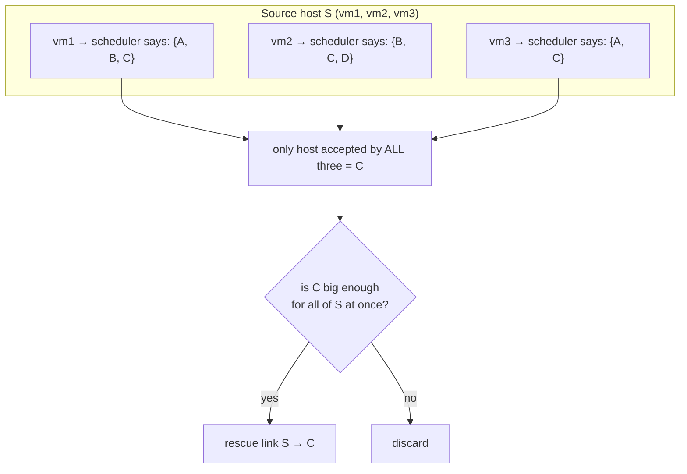
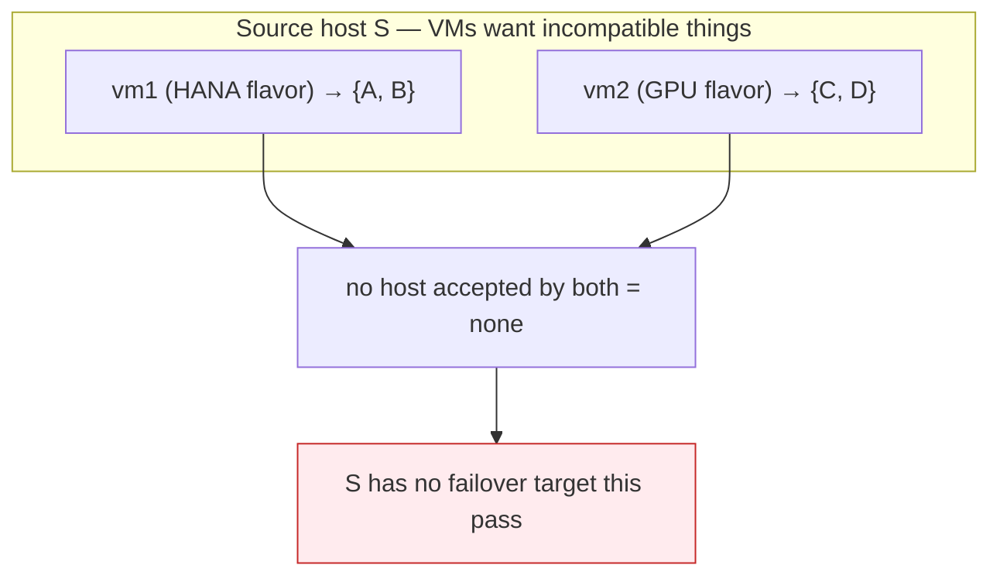
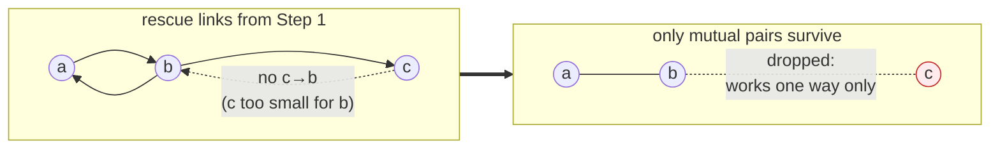
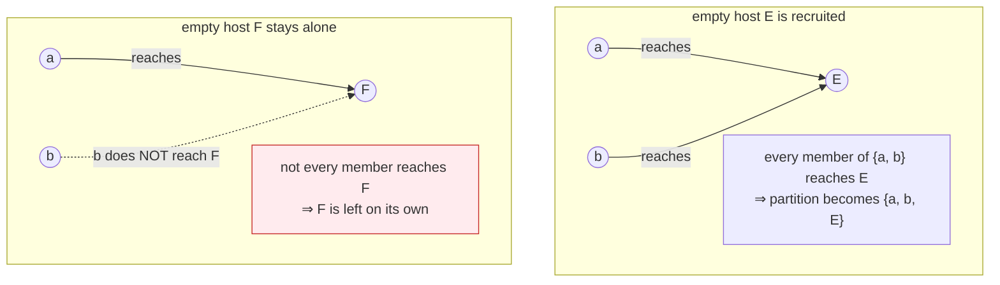
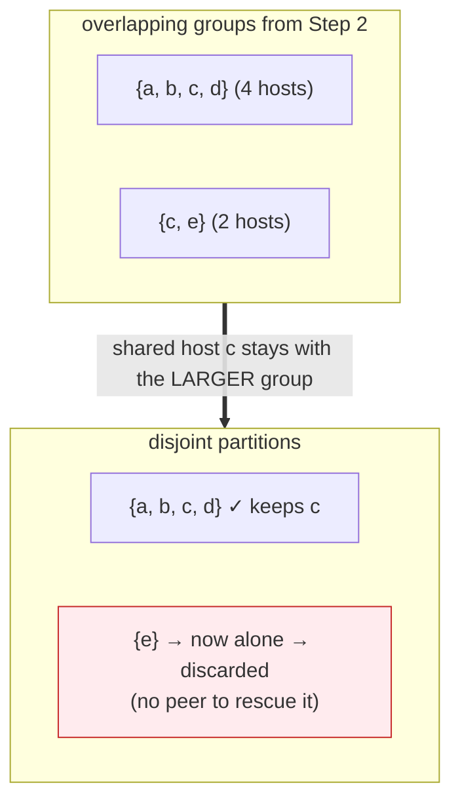
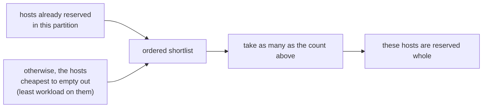
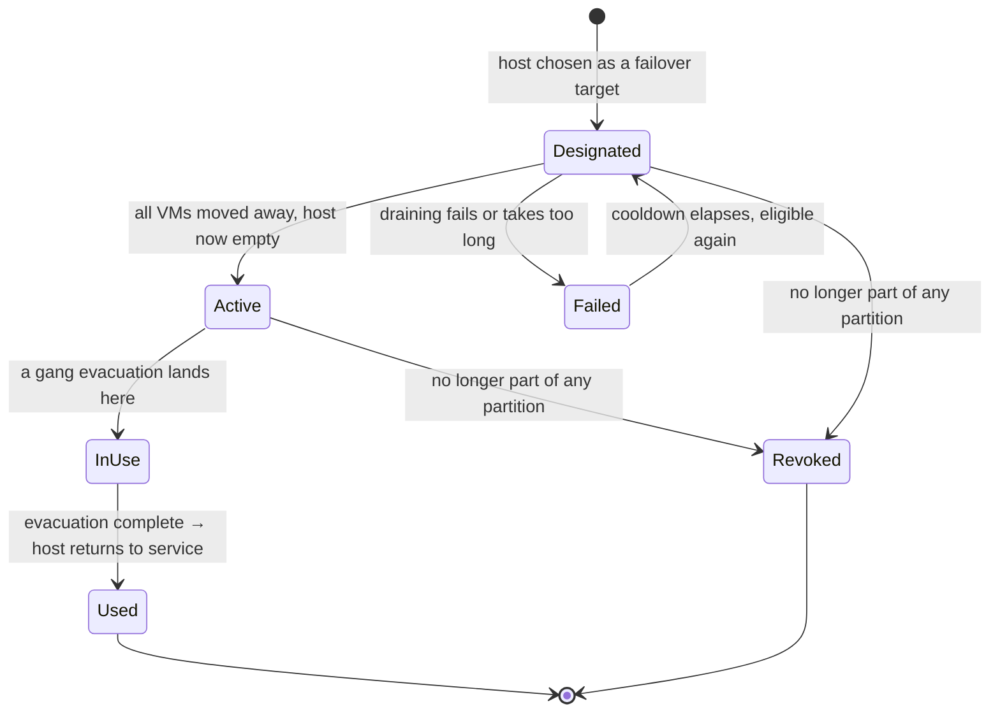

<!--
# SPDX-FileCopyrightText: Copyright SAP SE or an SAP affiliate company and cobaltcore-dev contributors
#
# SPDX-License-Identifier: Apache-2.0
-->

# Failover *host* reservations

The previous page reserved **headroom** — a shared pool of free capacity spread across the fleet, sized to
absorb `m` host failures. This page describes a different, coarser-grained mechanism that is replacing it:
instead of reserving scattered slots, Cortex keeps a fraction of **whole hosts** empty, so that when a host
dies its *entire* workload can be gang-evacuated onto one reserved host in a single move (*gang-evacuated*:
all the host's VMs moved together, in one placement decision, rather than one at a time).

> [!IMPORTANT]
> Failover host reservations **supersede** the slot-based failover reservations described on the
> [previous page](03-failover-reservations.md). The older system is deprecated and will be removed. New
> deployments should enable the failover-host reservations controller; the old slot-based controller is
> retained only for migration.

## Why whole hosts instead of shared slots

The slot-based model reserves headroom *cheaply* — a fraction of the fleet, shared across every protected
workload — but it pays for that with complexity and fragility at evacuation time:

- The reserved space is **scattered** across many hosts. Evacuating a failed host means fanning its VMs out
  across whatever slots happen to be free, which is exactly the placement problem the scheduler is slow and
  contended at precisely when a host has just died.
- Whether the headroom is actually *usable* for a given failure depends on the shape of the dead host's
  workload matching the shape of the scattered free space. The model reasons about *aggregate* capacity, not
  about whether any one host's workload truly fits.

Failover *host* reservations trade a little more idle capacity for a much simpler, more predictable
evacuation: each reserved host is a known-good, whole-host landing zone for exactly one source host's
workload, moved as a gang. There is no re-solving of placement under pressure — the target was pre-validated
by the scheduler while everything was calm.

```
Slot-based (previous):  reserve m hosts' worth of capacity, scattered as slots, shared across the fleet.
Host-based (this page): keep a ratio of whole hosts empty per partition; evacuate one host onto one host.
```

## Partitions: hosts are not interchangeable

Hosts cannot fail over onto *any* other host. A HANA host, a general-purpose host, and an external-customer
host each carry scheduling constraints — flavors, image properties, aggregates, availability zone — that only
matching hosts satisfy. A failover target is only useful if the dead host's VMs would actually be *accepted*
there.

Cortex therefore groups hosts into **failover partitions**: sets of hosts within which every host can be
evacuated onto every other host. Crucially, these groups are **not configured by hand**. They are *discovered*
from the scheduler's own placement decisions, so the grouping always reflects the live filters, weights and
constraints — a partition can never contain a target the scheduler would in fact reject.

Everything on this page is a continuous background process: Cortex periodically re-derives the partitions and
the set of reserved hosts from the current state of the fleet, and nudges the actual reservations toward that
freshly computed target. Nothing here is a one-time setup step; the picture re-settles every few minutes as
the fleet changes.

## How a reservation is kept up to date

The mechanism has two cooperating halves:

- A **planner** runs on a fixed interval (default every `5m`). It looks at the current fleet, works out which
  hosts *should* be reserved as failover targets, and publishes that as the desired picture. This is the
  expensive part — it talks to the scheduler — so it runs on a slow cadence, never on every event.
- A **reconciler** continuously nudges reality toward that desired picture: it creates reservations that
  should exist, removes ones that no longer should, and updates ones that have drifted. It is cheap, and it
  does nothing clever — it just closes the gap.



Because the planner republishes the **whole** desired picture each pass (rather than editing it in place), the
reconciler gets pruning for free: any reservation that exists in the fleet but is absent from the latest
picture is simply one the planner no longer wants, and is removed.



## How the planner decides: building the failover graph

The planner's job — "which hosts should be reserved?" — comes down to building a graph of who can rescue whom,
grouping that graph into partitions, and then reserving a fraction of each partition.

The important thing to understand is that the graph is **narrowed in several steps**, and each step throws out
candidates for a *different* reason. Keeping those reasons straight is the whole algorithm, because the single
most common question — *"why does this host have no failover target?"* — has a different answer at each step:



Each orange box is an edge case, worked through below. A [troubleshooting table](#why-does-this-host-have-no-failover-target)
at the end maps each symptom back to the step that caused it.

### Step 1 — Discover who can rescue whom

For every occupied host, Cortex finds the hosts that host's *entire* workload could be gang-evacuated onto.
The result is a set of directed **rescue links**:

> A link `source → target` means *"every VM on `source` would be accepted on `target`, and `target` is big
> enough to hold them all at once."*

Direction matters: `source → target` does **not** imply `target → source`. The target might simply be too
small to take the source's workload even when the reverse would fit.

Rather than reimplementing placement logic, Cortex **asks the real scheduler**, for each VM, where that VM
could go. This guarantees the rescue links obey exactly the same rules as ordinary placement. A host is a valid
target for a source only if it is accepted for **every** VM on that source — so Cortex intersects the
per-VM answers:



**Edge case — the host's own VMs disagree.** If the VMs on a host pull in different directions (say a HANA VM
and a GPU VM that no single host accepts together), the intersection is empty and the host gets **no rescue
links at all** — it goes unprotected this pass, even though it is running work:



This is a deliberate limitation: Cortex does not (yet) split one host's workload across several targets, so a
host whose own VMs cannot share a single landing zone simply waits until its workload mix changes.

Two things keep this probing faithful and safe:

- **Each probe mirrors a real evacuation** — it carries the VM's owner, availability zone, flavor and image, and
  tells the scheduler to treat it as an evacuation, so exactly the same filters apply as in a genuine failure.
- **The probing never changes anything.** It is strictly read-only, so asking "where could this VM go?"
  thousands of times never disturbs live scheduling. It also tells the scheduler to *ignore* existing failover
  host reservations — otherwise a host already reserved for failover would look occupied and vanish from its own
  partition, fragmenting the grouping.

Finally, a hard **whole-host fit** check discards any target that is smaller than its source (memory first,
then CPU). An evacuation moves *all* of the source's VMs onto the target at once, so the target must be at least
as large as the source.

If a single VM's lookup fails, it is skipped rather than aborting — one unschedulable VM shouldn't erase a whole
host's rescue links. Only an error broad enough to invalidate the entire pass stops it.

### Step 2 — Group hosts into partitions

A **failover partition is a set of hosts in which every host can be evacuated onto every other host.** For that
to hold, rescue must work in *both* directions between any two members: `a` can rescue `b` **and** `b` can
rescue `a`. So Step 2 first keeps only the **mutual** links — the one-way links from Step 1 are discarded here.

**One-way links are dropped.** This is why a link can exist in Step 1 yet leave no trace in the partitions:



Within the mutual graph, a partition is a group where **everyone can rescue everyone**. Finding the largest
such groups is a classic graph problem (finding *cliques*), and that is exactly what Cortex does — no hand
tuning, the groups fall straight out of the mutual links.

**Why groups, and why they can overlap.** Consider three hosts where `a`↔`b` and `b`↔`c` are mutual but `a`
and `c` cannot rescue each other. Then `{a, b, c}` is *not* a valid partition — `a` and `c` don't fit the "all
rescue all" rule. Instead there are two valid groups, `{a, b}` and `{b, c}`, and `b` sits in both. That overlap
is expected here; Step 3 resolves it.

**Empty hosts get folded in.** A host with no VMs (or one already reserved) has nothing to evacuate and so has
no rescue links of its own — it would otherwise be a group of one. Such a host is **recruited** into a partition
as long as **every** member of that partition can rescue onto it. The check is one-directional on purpose: an
empty host runs nothing, so it is assumed able to evacuate anywhere; only the inbound direction
(`member → empty host`) is verified. If even one member can't reach it, the empty host stays on its own:



The whole grouping is computed deterministically: given the same fleet, the same partitions come out every
time, so reservations don't flap between passes for no reason.

### Step 3 — Make the partitions disjoint

Step 2 can leave a host in **two** partitions at once (like `b` above). But a host can only be reserved for one
partition — reserving it for two would produce conflicting records about who it's meant to rescue, and one would
silently overwrite the other. So before planning, Cortex forces the partitions apart: each shared host is kept
in exactly **one** partition — the **largest** one it belongs to, since that's where it can rescue the most
peers (ties broken deterministically).



**Edge case — a host can silently lose coverage here.** When pulling a shared host out of the smaller group
leaves that group with only one host, the group is discarded (a lone host has no peer to fail over from). Above,
`e`'s only partner was `c`; once `c` stays with the larger group, `{e}` collapses to a single host and
disappears, leaving `e` unprotected this pass. Nothing about `e` itself changed — it lost its partition purely
from how the overlap was resolved. This is the subtlest way a host ends up with no failover target.

### Step 4 — Pick the failover hosts in each partition

For each partition, Cortex decides how many hosts to reserve as failover targets. It deliberately does **not**
pick a fixed number: too few leaves no room to evacuate into, too many wastes capacity. The count scales with
the partition size, under three rules:

- **A ratio of the partition** (default `10%`), rounded **down**.
- **A floor** (default `1`), so even a small partition keeps at least one target.
- **Never all of them** — at least one host must be left to actually run workload, so a partition is never
  fully reserved. And a partition of fewer than two hosts reserves nothing at all: there would be no peer for a
  reserved host to rescue.

Worked through for the defaults, the interplay is easier to see than to state:

| partition size | 10 %, rounded down | after the floor of 1 | after "leave ≥ 1 running" | **reserved** |
|---:|---:|---:|---:|---:|
| 1  | — | — | — | **0** (no peer) |
| 2  | 0 | 1 | 1  | **1** |
| 10 | 1 | 1 | 9  | **1** |
| 15 | 1 | 1 | 14 | **1** |
| 25 | 2 | 2 | 24 | **2** |

The floor dominates small partitions; the ratio only starts to matter once a partition is large enough that
10 % of it exceeds 1 (here, around 20 hosts).

**Which** hosts become the targets follows two preferences:



- **Already-reserved hosts stay reserved.** A host being prepared as a failover target may have VMs mid-way
  through being moved off it; flipping the designation each pass would throw that work away. If there are more
  already-reserved hosts than needed, the surplus is released back into normal service.
- **New targets are the cheapest to empty.** When a fresh target is needed, Cortex picks the host carrying the
  least workload, so draining it is as quick and cheap as possible. Each chosen host is then reserved in full,
  recording the other partition members as the hosts it stands ready to rescue.

## The reservation lifecycle

A failover host reservation blocks its target host from receiving ordinary placements, so the host stays empty
and available as a landing zone. Over its life a reservation moves through these stages:



- **Designated** — the host has been chosen as a target but may still have VMs that need draining off it. No
  *new* VMs are placed here. It stays in this stage until the host is empty.
- **Active** — the host is empty and ready to absorb an evacuation.
- **Failed** — draining failed repeatedly or took too long; the host is held back from being re-chosen for a
  cooldown period.
- **In Use** — a gang evacuation onto this host is underway (and may absorb further failures until it
  completes).
- **Revoked** — the host no longer belongs to any partition (for example it became unschedulable), so the
  reservation is dropped.
- **Used** — the failover event finished; the host becomes a regular host again.

> [!NOTE]
> Treat this diagram as the *intended progression*, not a strict state machine. The stages are tracked
> independently rather than as a single current-state field, so the arrows show the normal path rather than the
> only possible transitions.

## Configuration

Enable the controller and configure it under the nested `failover.hosts` key:

```yaml
enabledControllers:
  - failover-host-reservations-controller
# ...
failover:
  hosts:
    ratio: 0.1                 # fraction of each partition to reserve (0, 1]
    minimum: 1                 # floor per partition, > 0
    generationInterval: 5m     # how often to recompute, ≥ 1m
    externalSchedulerURL: "http://localhost:8080/scheduler/nova/external"
```

> [!NOTE]
> The settings live under `failover.hosts` as a deliberate example of grouping a controller's config under its
> own key rather than adding more flat top-level keys. This is independent of the (deprecated) slot-based
> failover controller configured alongside it. Bad values for `ratio`, `minimum`, or the interval are rejected
> at startup.

Like the other reservation kinds, failover host reservations make a host look fuller to the pipeline than its
raw capacity suggests — here by reserving the host **entirely**. The next page turns from the *kinds* of
reserved capacity to the concurrency problem all of them share: how the scheduler keeps parallel requests from
double-spending the same slot.

## Why does this host have no failover target?

Because the graph is narrowed in several steps, a host can end up unprotected for quite different reasons. This
table maps the symptom back to the step that caused it:

| Symptom | Why | Step |
|---|---|---|
| host produces no rescue links | its own VMs can't share any single target | 1 · Discover rescue links |
| a target was discarded | it's smaller than the source host | 1 · Discover rescue links |
| a link doesn't lead to a partition | it only works one way, not both | 2 · Group into partitions |
| an empty host is left on its own | not *every* member of a partition can reach it | 2 · Group into partitions |
| a host loses its partition | it was shared, kept by the larger group, and its old group collapsed | 3 · Make partitions disjoint |
| a partition reserves nothing | it has fewer than two hosts | 4 · Pick failover hosts |

The controller logs each of these decisions as it makes them, so a host's fate through the steps can be traced
pass by pass.

## Next

[Prev: Failover reservations (deprecated)](03-failover-reservations.md) · [Next: Concurrency and in-flight reservations »](05-concurrency-and-in-flight-reservations.md)
