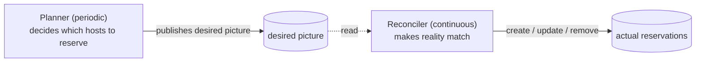
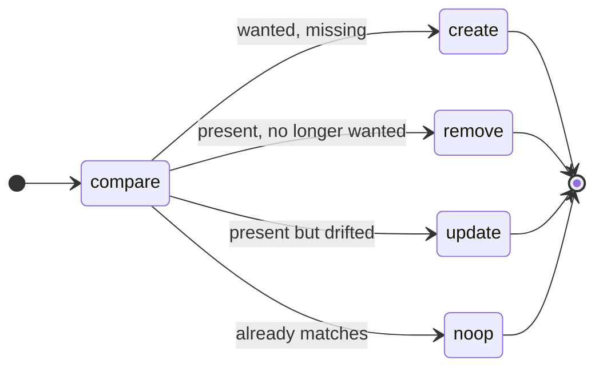
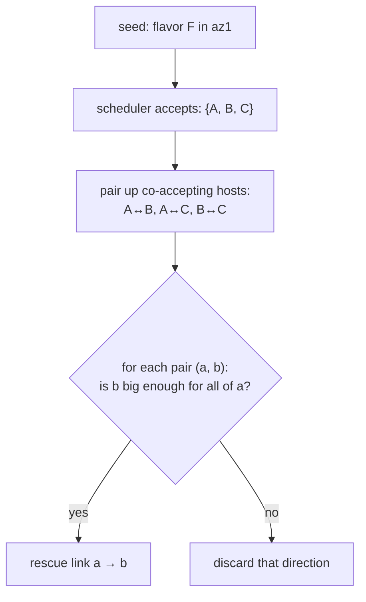
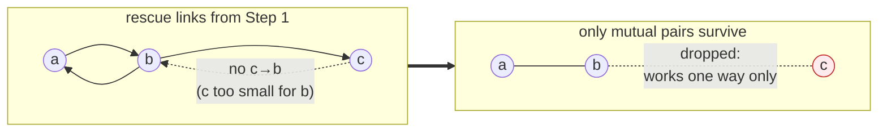
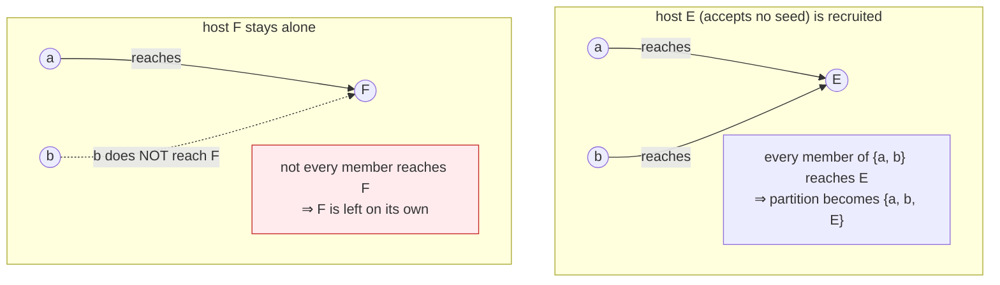
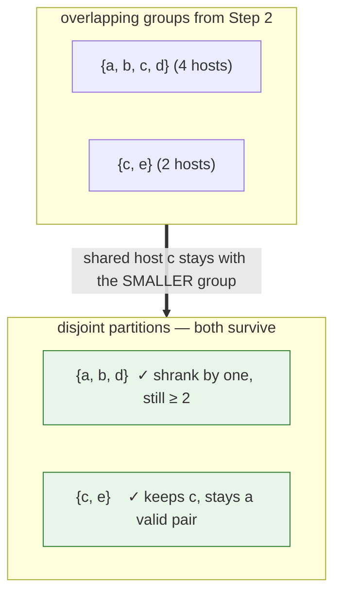
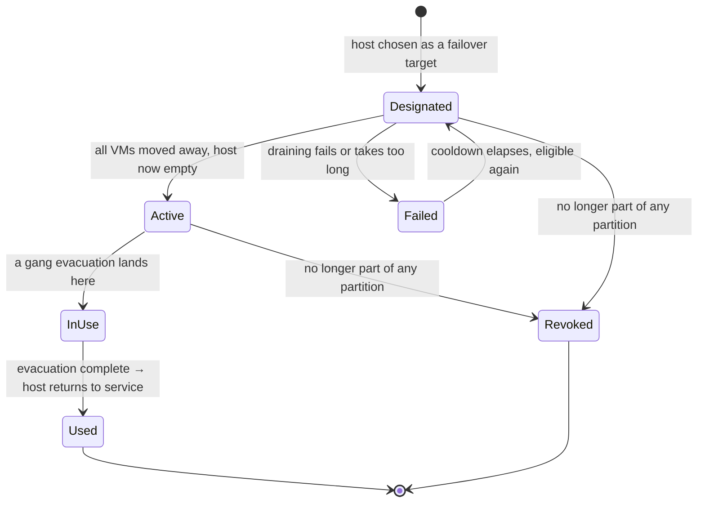

<!--
# SPDX-FileCopyrightText: Copyright SAP SE or an SAP affiliate company and cobaltcore-dev contributors
#
# SPDX-License-Identifier: Apache-2.0
-->

# Failover host reservations

The previous page reserved **headroom** — a shared pool of free capacity spread across the fleet, sized to
absorb `m` host failures. This page describes a different, coarser-grained mechanism that is replacing it:
instead of reserving scattered slots, Cortex keeps a fraction of **whole hosts** empty, so that when a host
dies its *entire* workload can be gang-evacuated onto one reserved host in a single move (*gang-evacuated*:
all the host's VMs moved together, in one placement decision, rather than one at a time).

> [!IMPORTANT]
> Failover host reservations **supersede** the slot-based failover reservations described on the
> [previous page](03-failover-reservations.md). The older system is deprecated and will be removed. New
> deployments should enable the failover-host reservations controller; the old slot-based controller is
> retained only for migration. The key reason for the switch: whole-host reservations trade a little more
> idle capacity for a pre-validated, gang-evacuable landing zone, so no placement has to be re-solved under
> pressure the moment a host dies.

## Partitions: hosts are not interchangeable

Hosts cannot fail over onto *any* other host. A HANA host, a general-purpose host, and an external-customer
host each carry scheduling constraints — flavors, image properties, aggregates, availability zone — that only
matching hosts satisfy. A failover target is only useful if the dead host's VMs would actually be *accepted*
there.

Cortex therefore groups hosts into **failover partitions**: sets of hosts within which every host can be
evacuated onto every other host. Crucially, these groups are **not configured by hand**. They are *discovered*
from the scheduler's own placement decisions, so the grouping always reflects the live filters, weights and
constraints — a partition can never contain a target the scheduler would in fact reject.

One could imagine solving this differently: hand-craft the partitions from the hypervisors directly — write
rules that read each host's flavors, image properties, aggregates and availability zone and group the
"compatible" ones together. But those are exactly the constraints the VM scheduling pipeline *already*
encodes. Re-expressing them here would mean re-implementing a second, parallel copy of the placement logic,
which then has to be kept in lock-step with the real one forever; the moment a filter changes in the pipeline
and not in the failover rules, the partitions quietly diverge from what the scheduler would actually accept,
and a "failover target" may reject the very workload it was reserved for.

So Cortex takes a **self-partitioning approach** instead. Rather than restating the rules, it asks the real
scheduler — per **flavor** — which hosts would accept that flavor, and lets the partitions *fall out* of those
answers (the next section works through how). The compatibility rules are never duplicated: whatever the
pipeline does, the partitions inherit, automatically and for free, including every future change to the
filters and weighers.

The probes are seeded from the **flavor catalogue**, not from the VMs that happen to be running. For every
flavor Nova knows about — crossed with every availability zone in the fleet — Cortex asks the scheduler which
hosts would accept it. These `(flavor, availability zone)` permutations are the **seeds** of the partitioning.
Seeding from flavors rather than running VMs closes two blind spots the VM-based approach had:

- **A group of hosts running no VMs is still discovered.** Flavor seeds exist whether or not anything is
  currently scheduled, so a partition is found up front rather than only once a VM happens to land on one of its
  hosts.
- **One "exotic" VM can no longer veto a host.** Because seeds carry no host affiliation, a single VM whose
  scheduling constraints no peer satisfies can never keep its host out of the partition it matches under every
  other flavor.

Everything on this page is a continuous background process: Cortex periodically re-derives the partitions and
the set of reserved hosts from the current state of the fleet, and nudges the actual reservations toward that
freshly computed target. Nothing here is a one-time setup step; the picture re-settles every few minutes as
the fleet changes.

## How a reservation is kept up to date

The mechanism has two cooperating halves:

- A **planner** runs on a fixed interval (default every `5m`). It looks at the current fleet, works out which
  hosts *should* be reserved as failover targets, and publishes that as the desired picture. This is the
  expensive part — it talks to the scheduler — so it runs on a slow cadence, never on every event.
- A **reconciler** continuously nudges reality toward that desired picture: it creates reservations that
  should exist, removes ones that no longer should, and updates ones that have drifted. It is cheap, and it
  does nothing clever — it just closes the gap.



Because the planner republishes the **whole** desired picture each pass (rather than editing it in place), the
reconciler gets pruning for free: any reservation that exists in the fleet but is absent from the latest
picture is simply one the planner no longer wants, and is removed.

A corollary matters for safety: the planner only ever publishes a picture it computed from a *complete*
snapshot. If anything goes wrong while gathering the inputs — the fleet snapshot can't be collected, or a
scheduler probe fails — the whole pass is aborted and the previously published picture is left untouched; the
planner simply retries on the next cycle. The reconciler therefore never acts on a half-gathered view, and
reservations are never recomputed from partial data.



## How the planner decides: building the failover graph

The planner's job — "which hosts should be reserved?" — comes down to building a graph of who can rescue whom,
grouping that graph into partitions, and then reserving a fraction of each partition.

The important thing to understand is that the graph is **narrowed in several steps**, and each step throws out
candidates for a *different* reason. Keeping those reasons straight is the whole algorithm, because the single
most common question — *"why does this host have no failover target?"* — has a different answer at each step:

1. **Discover who can rescue whom** (Step 1 below). For every flavor seed, ask the scheduler which hosts would
   accept it, then pair up the hosts that co-accept a seed and keep the pair only if the target is big enough
   for the whole source host — yielding one-way rescue links `source → target`. *A target drops out if it is
   smaller than the source.*
2. **Group into partitions** (Step 2). Keep only links that work *both* ways, then cluster those mutual pairs
   into groups where everyone can rescue everyone. *A one-way link leaves no trace in the partitions.*
3. **Make the partitions disjoint** (Step 3). A host can land in two overlapping groups; assign it to one.
   *A group left with a single host is then discarded.*
4. **Pick the failover hosts** (Step 4). Reserve a fraction of each partition as empty landing zones.

Each emphasised clause is an edge case, worked through below. A
[troubleshooting table](#why-does-this-host-have-no-failover-target) at the end maps each symptom back to the
step that caused it.

### Why Bron-Kerbosch for the partitioning

Step 2 reduces to a classic graph question: in the undirected graph of mutual rescue pairs, a failover
partition is a set of hosts that are *all pairwise* connected — a **maximal clique**. Cortex enumerates those
cliques with the **Bron-Kerbosch** algorithm, and the choice is deliberate:

- **The problem is literally maximal-clique enumeration, not something weaker.** "Every host can evacuate onto
  every other host" is the definition of a clique. Cheaper alternatives solve a *different* problem and would
  silently admit invalid partitions: connected components or a union-find grouping would lump together hosts
  linked only transitively (`a`↔`b`, `b`↔`c` but not `a`↔`c`), producing a "partition" in which `a` cannot
  actually rescue `c`. A greedy "grow a group while everyone stays connected" heuristic avoids that but picks
  an arbitrary clique and misses overlapping ones, so some hosts would lose a partition they genuinely belong
  to.
- **We need *all maximal* cliques, including overlapping ones.** A host can legitimately belong to more than
  one partition (it is Step 3's own job to resolve that overlap afterwards). Bron-Kerbosch is the standard,
  well-understood algorithm that enumerates *exactly* the maximal cliques — no duplicates, nothing missed —
  which is what makes the downstream overlap-resolution well-defined.
- **The fleet is partitioned by construction, so the worst case never bites.** Maximal-clique enumeration is
  exponential in the general case, which sounds alarming. But the mutual-rescue graph is not a general graph:
  it is already almost-disconnected into compatibility islands (HANA, general-purpose, external-customer, …),
  and cliques only form *within* an island. Each clique-search therefore runs over a small, dense subgraph,
  not the whole fleet, which keeps it comfortably fast in practice.

With that settled, the four steps in detail:

### Step 1 — Discover who can rescue whom

Cortex finds, for every host, the hosts that host's *entire* workload could be gang-evacuated onto. The result
is a set of directed **rescue links**:

> A link `source → target` means *"`source`'s whole workload would be accepted on `target`, and `target` is big
> enough to hold it at once."*

Direction matters: `source → target` does **not** imply `target → source`. The target might simply be too
small to take the source's workload even when the reverse would fit.

Rather than reimplementing placement logic, Cortex **asks the real scheduler** — once per **flavor seed** —
which hosts would accept that flavor in that availability zone. This guarantees the rescue links obey exactly
the same rules as ordinary placement. The hosts that *co-accept* a seed are mutually compatible under that
flavor, so Cortex pairs them up: for every ordered pair `(a, b)` of hosts that both accept a seed it emits the
link `a → b`, subject to the whole-host fit check below.



Because the seeds come from the flavor catalogue rather than the running VMs, two failure modes of the old
VM-based discovery simply disappear:

- **A group of hosts running no VMs is still discovered.** A flavor seed exists regardless of what is currently
  scheduled, so such a group produces rescue links and forms its partition up front — no VM has to land on it
  first.
- **One "exotic" VM can no longer veto a host.** Discovery no longer intersects the answers for a *host's own*
  VMs, so a single VM whose constraints no peer satisfies can never empty that intersection and keep its host
  out of the partition it matches under every other flavor.

Three things keep this probing faithful and safe:

- **Each probe mirrors a real evacuation** — it carries the flavor, its availability zone and a KVM image
  hypervisor type, so exactly the same filters apply as in a genuine move, and tells the scheduler to treat it
  as an **evacuation** (a cold migration). The choice of *evacuation* over *live migration* is deliberate. A
  failover ultimately *evacuates* a dead host's workload — a cold migration, which is the **weaker** check: it
  does not verify the CPU architecture, CPU modes, hypervisor features and emulated devices that live migration
  does. A failover target is still reserved **empty**, so before its reservation goes active Cortex must drain
  whatever runs on it; that drain uses live migration. But rather than prove per host that every peer is
  live-migratable at partition time, Cortex assumes a partition holds enough peers to absorb that drain and
  leaves arranging it to the draining code. Probing with the evacuation (cold-migration) requirement is what
  lets a partition form even across hosts that are not pairwise live-migratable.
- **Candidates are judged as if empty.** The probe tells the scheduler to measure each candidate against its
  *total* capacity, ignoring whatever VMs currently run there. This is deliberate: a failover target is reserved
  **empty**, so the right question is "could this host hold the workload once cleared?", not "does it have room
  right now?". Were the probe to measure live free capacity instead, a busy host would accept no one, gain no
  inbound rescue link, form no mutual edge, and stay orphaned — even though reserving it would drain it. Whether
  two hosts are *compatible* is thus independent of how full they happen to be; which host is cheapest to
  actually empty is decided later, in Step 4.
- **The probing never changes anything.** It is strictly read-only, so asking "where could this flavor go?" for
  every seed never disturbs live scheduling. It also tells the scheduler to *ignore* existing failover host
  reservations — otherwise a host already reserved for failover would look occupied and vanish from its own
  partition, fragmenting the grouping.

A hard **whole-host fit** check discards any target that is smaller than its source (memory first, then CPU).
An evacuation moves *all* of the source's workload onto the target at once, so the target must be at least as
large as the source. This check compares *total* capacities, independent of the empty-host probing above, so an
undersized target is dropped whether or not it currently runs anything. Equal-sized co-accepting hosts
therefore produce links in *both* directions, which Step 2 turns into a partition; an undersized host only ever
appears as a source, never as a landing-zone target for a larger peer.

Two outcomes of a seed lookup must not be confused, because they are handled oppositely — and the distinction
is exactly what upholds the "consistent picture or nothing" rule:

- **The scheduler accepts the seed on fewer than two hosts** (one host, or none — a short candidate set, no
  error). This is a valid answer, not a failure. A seed accepted on fewer than two hosts can form no pair, so it
  simply contributes no link, and the pass continues normally.
- **The lookup itself fails** (the scheduler is unreachable, times out, or returns a non-200) — or the seed set
  itself cannot be gathered, because Nova is unreachable. This is an infrastructure failure, not an answer — on
  a partial view Cortex cannot assert anything about the failover graph, so it **aborts the entire pass** and
  leaves the last published picture untouched, retrying next cycle. Swallowing the error and skipping just that
  seed would collapse rescue links and prune reservations that are in fact still valid, so a single transient
  blip must never be allowed to erase coverage.

### Step 2 — Group hosts into partitions

A **failover partition is a set of hosts in which every host can be evacuated onto every other host.** For that
to hold, rescue must work in *both* directions between any two members: `a` can rescue `b` **and** `b` can
rescue `a`. So Step 2 first keeps only the **mutual** links — the one-way links from Step 1 are discarded here.

**One-way links are dropped.** This is why a link can exist in Step 1 yet leave no trace in the partitions:

The reason mutuality is required — not just a convenient graph property — is that a failover must be
*reversible*. A VM evacuated onto a target host should not be **locked in** there once the original host
recovers. If rescue only worked one way (`source → target` but not back), the evacuated workload could land on
the target and then have nowhere to return to, stranding it. Insisting the link work in *both* directions
guarantees the partition can be restored: after the evacuation, the VMs can fail back off the target just as
they failed onto it, so the partition returns to a fully failover-able state rather than degrading with each
event.



Within the mutual graph, a partition is a group where **everyone can rescue everyone**. Finding the largest
such groups is a classic graph problem (finding *cliques*), and that is exactly what Cortex does — no hand
tuning, the groups fall straight out of the mutual links.

**Why groups, and why they can overlap.** Consider three hosts where `a`↔`b` and `b`↔`c` are mutual but `a`
and `c` cannot rescue each other. Then `{a, b, c}` is *not* a valid partition — `a` and `c` don't fit the "all
rescue all" rule. Instead there are two valid groups, `{a, b}` and `{b, c}`, and `b` sits in both. That overlap
is expected here; Step 3 resolves it.

**Hosts that accept no seed get folded in.** Because discovery now probes flavor seeds rather than running VMs,
a host with no VMs on it is probed exactly like any other and, as long as it *accepts some seed*, forms rescue
links and joins a clique directly — no special handling needed. The one case left over is a host that accepts
**no seed at all** (for example an unschedulable host that every filter rejects): it has no rescue links of its
own and would otherwise be a group of one. Such a host is **recruited** into a partition as long as **every**
member of that partition can rescue onto it *and* it is the same effective size as those members. The
reachability check is one-directional on purpose: the host would be reserved empty, so it is assumed able to
evacuate anywhere; only the inbound direction (`member → host`) is verified. But the host also becomes a
*source* of the partition's eventual failover target, so it must itself be rescuable by its new peers. Having no
rescue links to prove this, Cortex falls back to the same whole-host fit rule used in Step 1 and requires equal
capacity (memory then CPU, rounded to GiB): a host larger than the partition could never be evacuated onto a
smaller reserved target, so it is **not** recruited. If even one member can't reach it, or the sizes differ, the
host stays on its own:

Flavor seeding also removes a blind spot the old VM-based discovery had: **a partition no longer needs a running
VM to be discovered.** Rescue links used to be derived *from* running VMs, so a group of hosts with no VMs at
all produced no links, formed no clique, and stayed invisible — a HANA partition with no HANA VM running simply
did not exist until one landed. With flavor seeds the HANA flavor is probed whether or not anything runs, so the
partition is found up front and a failover host can be reserved before the first VM ever arrives.



The whole grouping is computed deterministically: given the same fleet, the same partitions come out every
time, so reservations don't flap between passes for no reason.

### Step 3 — Make the partitions disjoint

Step 2 can leave a host in **two** partitions at once (like `b` above). But a host can only be reserved for one
partition — reserving it for two would produce conflicting records about who it's meant to rescue, and one would
silently overwrite the other. So before planning, Cortex forces the partitions apart: each shared host is kept
in exactly **one** partition — the **smallest** one it belongs to (ties broken deterministically by the
partition's first host name).

Keeping the shared host in the *smallest* partition is what preserves coverage for as many partitions as
possible. A small partition only survives if it keeps its shared hosts — losing one can drop it below the
two-host minimum and collapse it entirely. A large partition, by contrast, usually stays well above that
minimum even after giving a host up. So assigning the shared host to the smaller group lets *both* groups
survive, whereas assigning it to the larger one would often strand the smaller group:



Had `c` instead been kept with the larger `{a, b, c, d}`, the pair `{c, e}` would have collapsed to the lone
host `{e}` and been discarded (a lone host has no peer to fail over from), leaving `e` unprotected this pass
for no reason other than how the overlap was resolved. Preferring the smaller partition removes that failure
mode wherever the larger partition can spare the host — which, being larger, it usually can.

**Edge case — coverage can still be lost when neither partition can spare the host.** The smallest-first rule
does not make the problem vanish entirely: if a host is shared between two partitions that are *both* size two,
whichever one loses it collapses to a lone host and is discarded. There is no assignment that saves both — the
host is the only peer each has — so one partition is unavoidably stranded, and the deterministic tiebreak
decides which. This is now the only way the disjoint step costs a host its failover target.

### Step 4 — Pick the failover hosts in each partition

For each partition, Cortex decides how many hosts to reserve as failover targets. It deliberately does **not**
pick a fixed number: too few leaves no room to evacuate into, too many wastes capacity. The count scales with
the partition size, under three rules:

- **A ratio of the partition** (default `10%`), rounded **down**.
- **A floor** (default `1`), so even a small partition keeps at least one target.
- **Never all of them** — at least one host must be left to actually run workload, so a partition is never
  fully reserved. And a partition of fewer than two hosts reserves nothing at all: there would be no peer for a
  reserved host to rescue.

Worked through for the defaults, the interplay is easier to see than to state:

| partition size | 10 %, rounded down | after the floor of 1 | after "leave ≥ 1 running" | **reserved** |
|---:|---:|---:|---:|---:|
| 1  | — | — | — | **0** (no peer) |
| 2  | 0 | 1 | 1  | **1** |
| 10 | 1 | 1 | 9  | **1** |
| 15 | 1 | 1 | 14 | **1** |
| 25 | 2 | 2 | 24 | **2** |

The floor dominates small partitions; the ratio only starts to matter once a partition is large enough that
10 % of it exceeds 1 (here, around 20 hosts).

**Which** hosts become the targets comes down to the *order* in which the partition's hosts are considered.
Cortex builds one ordered slice of candidates and then simply takes the first `reserved`-many from it. The
order is what encodes the policy — and it is built to **retain existing reservations first and only create new
ones when the count demands it**:

```
candidate order  ──────────────────────────────────────────────────────────────▶
┌───────────────────────────────┬───────────────────────────────────────────────┐
│  already-reserved hosts       │  not-yet-reserved hosts                       │
│  (this partition), by name    │  by ascending workload (cheapest to empty)    │
├───────────────────────────────┼───────────────────────────────────────────────┤
│  R1   R2   R3        …        │  N1   N2   N3   N4   …                        │
└───────────────────────────────┴───────────────────────────────────────────────┘
        └──────────── take the first `reserved` of these ────────────┘
                 kept reservations are consumed before any new one is created
```

Reading the slice left to right:

- **Already-reserved hosts come first, so they stay reserved.** A host being prepared as a failover target may
  have VMs mid-way through being moved off it; flipping the designation each pass would throw that work away.
  Because they sit at the front, the planner only reaches a *new* host once every existing reservation has
  already been re-chosen. If there are *more* already-reserved hosts than the count needs, the surplus falls
  past the cut-off and is released back into normal service; if there are fewer, the remainder is filled from
  the new hosts.
- **New targets, when needed, are the cheapest to empty.** The not-yet-reserved hosts are ordered by ascending
  workload, so the first new host the planner reaches is the one whose VMs are cheapest to migrate away.

So in the common steady state where the right number of hosts is already reserved, the cut-off lands exactly
at the boundary between the two groups: every existing reservation is retained and no new one is created. New
reservations only appear when the count grows or an existing target leaves the partition.

Each chosen host is then reserved in full, recording the other partition members as the hosts it stands ready
to rescue.

## The reservation lifecycle

A failover host reservation blocks its target host from receiving ordinary placements, so the host stays empty
and available as a landing zone. Over its life a reservation moves through these stages:



- **Designated** — the host has been chosen as a target but may still have VMs that need draining off it. No
  *new* VMs are placed here. It stays in this stage until the host is empty.
- **Active** — the host is empty and ready to absorb an evacuation.
- **Failed** — draining failed repeatedly or took too long; the host is held back from being re-chosen for a
  cooldown period.
- **In Use** — a gang evacuation onto this host is underway (and may absorb further failures until it
  completes).
- **Revoked** — the host no longer belongs to any partition (for example it became unschedulable), so the
  reservation is dropped.
- **Used** — the failover event finished; the host becomes a regular host again.

> [!NOTE]
> Treat this diagram as the *intended progression*, not a strict state machine. The stages are tracked
> independently rather than as a single current-state field, so the arrows show the normal path rather than the
> only possible transitions.

## Configuration

Enable the controller and configure it under the nested `failover.hosts` key:

```yaml
enabledControllers:
  - failover-host-reservations-controller
# ...
failover:
  hosts:
    ratio: 0.1                 # fraction of each partition to reserve (0, 1]
    minimum: 1                 # floor per partition, > 0
    generationInterval: 5m     # how often to recompute, ≥ 1m
    externalSchedulerURL: "http://localhost:8080/scheduler/nova/external"
    nova:                      # credentials for listing the flavors to seed with
      keystoneSecretRef:
        name: cortex-openstack
        namespace: cortex
      # ssoSecretRef: { name: ..., namespace: ... }   # optional SSO client cert
```

The `nova` block points at the OpenStack credentials the controller uses to list the Nova flavor catalogue —
the seeds the partitioning is built from (see [Step 1](#step-1--discover-who-can-rescue-whom)). It reuses the
same keystone (and optional SSO) secret shape as the other OpenStack-facing reservation controllers.

> [!NOTE]
> The settings live under `failover.hosts` as a deliberate example of grouping a controller's config under its
> own key rather than adding more flat top-level keys. This is independent of the (deprecated) slot-based
> failover controller configured alongside it. Bad values for `ratio`, `minimum`, or the interval are rejected
> at startup.

Like the other reservation kinds, failover host reservations make a host look fuller to the pipeline than its
raw capacity suggests — here by reserving the host **entirely**. The next page turns from the *kinds* of
reserved capacity to the concurrency problem all of them share: how the scheduler keeps parallel requests from
double-spending the same slot.

## Why does this host have no failover target?

Because the graph is narrowed in several steps, a host can end up unprotected for quite different reasons. This
table maps the symptom back to the step that caused it:

| Symptom | Why | Step |
|---|---|---|
| a host accepts no seed, gets no rescue links | every filter rejects it (e.g. it is unschedulable) | 1 · Discover rescue links |
| a target was discarded | it's smaller than the source host | 1 · Discover rescue links |
| a link doesn't lead to a partition | it only works one way, not both | 2 · Group into partitions |
| a host that accepts no seed is left on its own | not *every* member of a partition can reach it | 2 · Group into partitions |
| a host loses its partition | it was shared between two size-two partitions, and the one that lost it collapsed | 3 · Make partitions disjoint |
| a partition reserves nothing | it has fewer than two hosts | 4 · Pick failover hosts |

The controller logs each of these decisions as it makes them, so a host's fate through the steps can be traced
pass by pass.

## Next

[Prev: Failover reservations (deprecated)](03-failover-reservations.md) · [Next: Concurrency and in-flight reservations »](05-concurrency-and-in-flight-reservations.md)
