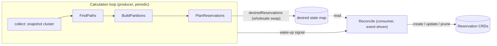
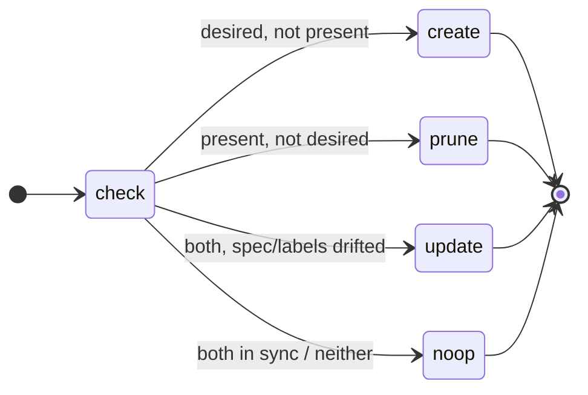
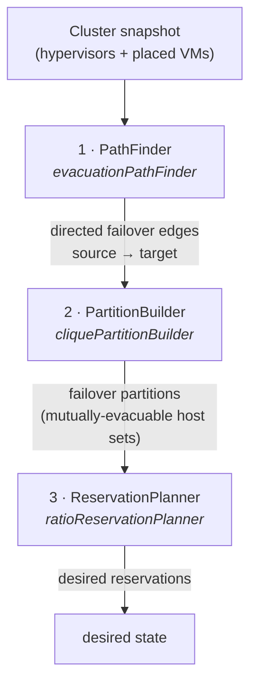
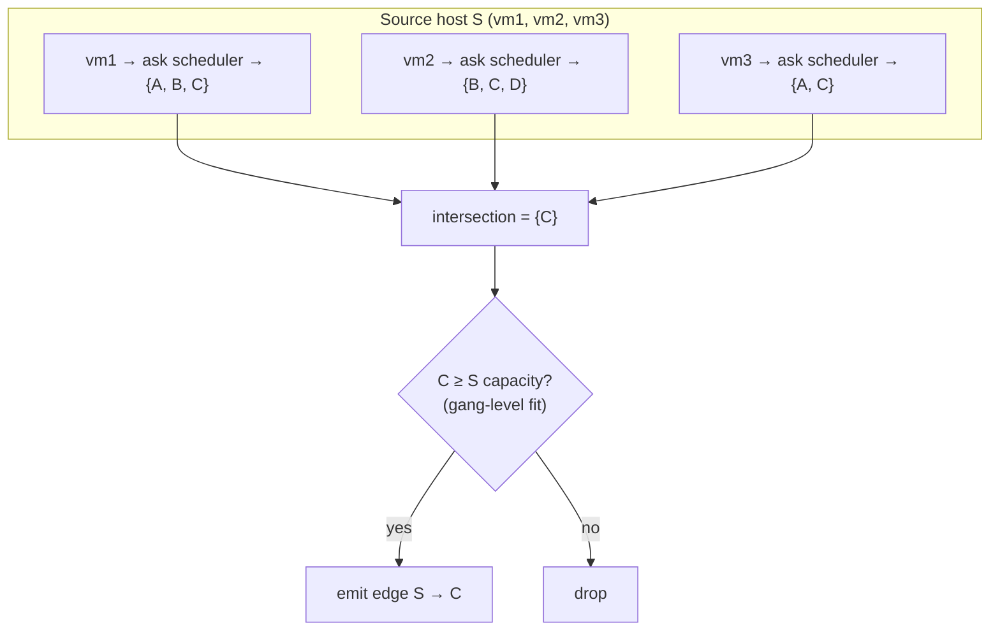
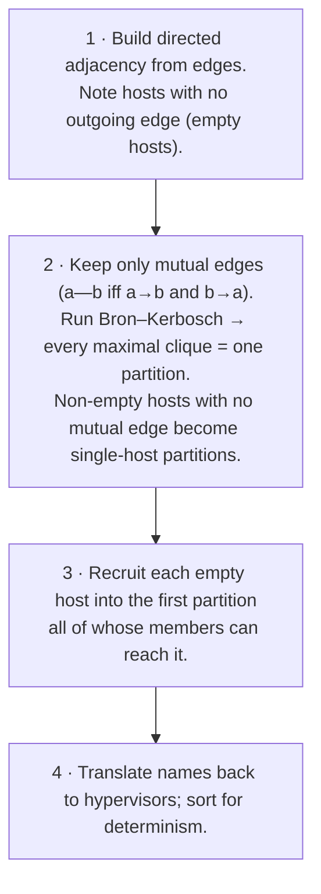
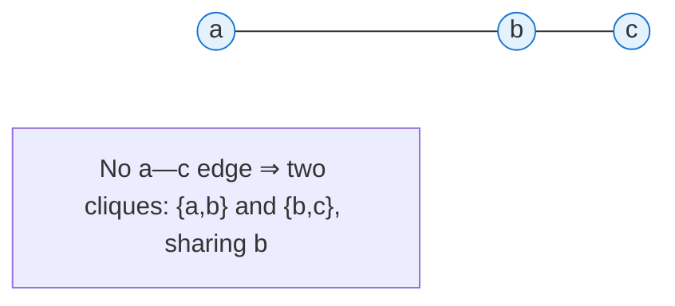
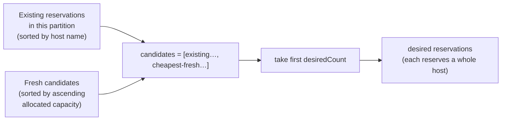
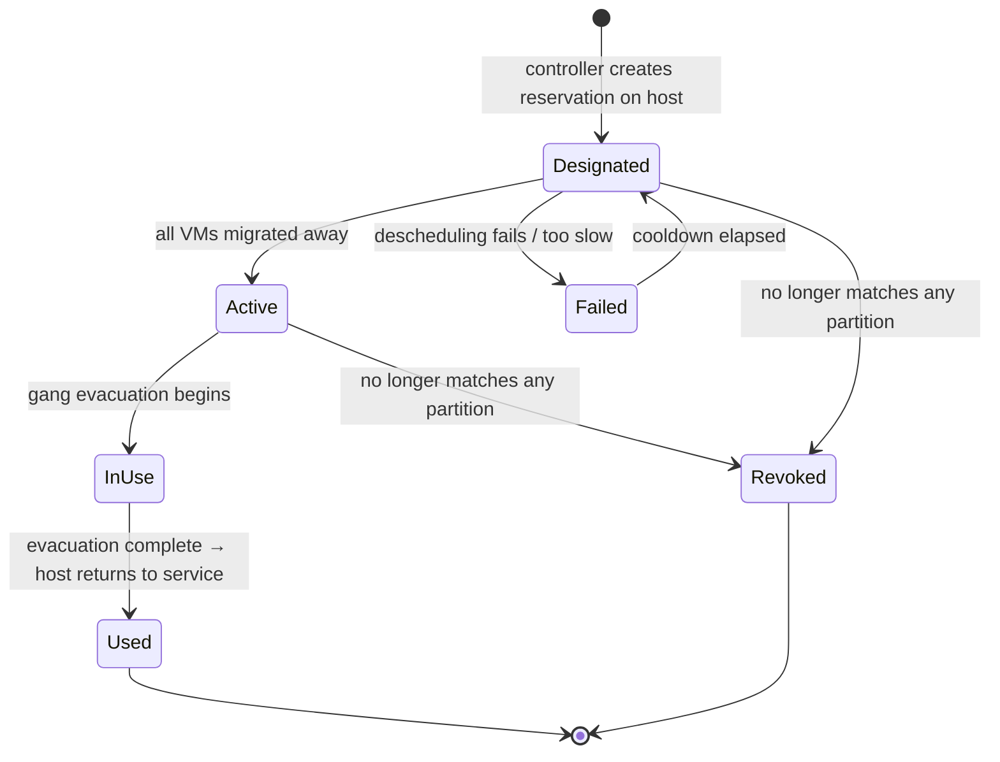

<!--
# SPDX-FileCopyrightText: Copyright SAP SE or an SAP affiliate company and cobaltcore-dev contributors
#
# SPDX-License-Identifier: Apache-2.0
-->

# Failover *host* reservations

The previous page reserved **headroom** — a shared pool of free capacity spread across the fleet, sized to
absorb `m` host failures. This page describes a different, coarser-grained mechanism that is replacing it:
instead of reserving scattered slots, Cortex keeps a fraction of **whole hosts** empty, so that when a host
dies its *entire* workload can be gang-evacuated onto one reserved host in a single move.

> [!IMPORTANT]
> Failover host reservations (`FailoverHostReservation`) **supersede** the slot-based failover reservations
> (`FailoverReservation`) described on the [previous page](03-failover-reservations.md). The older system is
> deprecated and will be removed. New deployments should enable the `failover-host-reservations-controller`;
> the `failover-reservations-controller` is retained only for migration.

## Why whole hosts instead of shared slots

The slot-based model reserves headroom *cheaply* — a fraction of the fleet, shared across every protected
workload — but it pays for that with complexity and fragility at evacuation time:

- The reserved space is **scattered** across many hosts. Evacuating a failed host means fanning its VMs out
  across whatever slots happen to be free, which is exactly the placement problem the scheduler is slow and
  contended at precisely when a host has just died.
- Whether the headroom is actually *usable* for a given failure depends on the shape of the dead host's
  workload matching the shape of the scattered free space. The model reasons about *aggregate* capacity, not
  about whether any one host's workload truly fits.

Failover *host* reservations trade a little more idle capacity for a much simpler, more predictable
evacuation: each reserved host is a known-good, whole-host landing zone for exactly one source host's
workload, moved as a gang. There is no re-solving of placement under pressure — the target was pre-validated
by the scheduler while everything was calm.

```
Slot-based (previous):  reserve m hosts' worth of capacity, scattered as slots, shared across the fleet.
Host-based (this page): keep a ratio of whole hosts empty per partition; evacuate one host onto one host.
```

## Partitions: hosts are not interchangeable

Hosts cannot fail over onto *any* other host. A HANA host, a general-purpose host, and an external-customer
host each carry scheduling constraints — flavors, image properties, aggregates, availability zone — that only
matching hosts satisfy. A failover target is only useful if the dead host's VMs would actually be *accepted*
there.

Cortex therefore groups hosts into **failover partitions**: maximal sets of hosts within which every host can
be evacuated onto every other host. Crucially, these groups are **not configured by hand**. They are
*discovered* from the scheduler's own placement decisions, so the grouping always reflects the live filters,
weighers and constraints — a partition can never contain a target the scheduler would in fact reject.

## The controller: a producer and a consumer

The `failover-host-reservations-controller` has two cooperating halves that communicate through an in-memory
*desired state* map:



- The **calculation loop** (`Start` → `loop`) recomputes the desired set of failover host reservations from
  current cluster state on a fixed interval (`generationInterval`, default `5m`) and stores it. It is the
  single writer of the desired-state map. It is deliberately the *only* place the expensive, external-call-heavy
  computation runs — never the reconcile path.
- The **reconciler** (`Reconcile`) is woken by the loop and drives the actual `Reservation` objects toward the
  stored desired set. It is level-triggered and idempotent: each call reads actual and desired state and makes
  at most one write.

Because the loop swaps the desired-state map **wholesale** each pass (rather than mutating it), the reconciler
can detect staleness for free: anything present in the cluster but absent from the new map is pruned.



## The calculation pipeline

Each pass of the loop runs a three-stage pipeline, each stage a small interface so it can be understood,
tested and swapped in isolation.



### Stage 1 — PathFinder: discover the failover edges

For every occupied host, the `PathFinder` finds the hosts that host's *entire* workload could be
gang-evacuated onto. It produces the **directed edges** of a failover graph:

> An edge `source → target` means *"every VM on `source` can be evacuated onto `target`, and `target` is big
> enough to hold them all at once."*

The direction matters: `source → target` does **not** imply `target → source`. `target` might be too small for
`source`'s workload even if the reverse fits.

Rather than reimplementing placement, the `evacuationPathFinder` **asks the real external scheduler**, per VM,
where that VM could be evacuated to. This guarantees failover paths obey exactly the same filters, weighers and
constraints as ordinary placement. A target host for `source` is valid only if it is accepted for **every** VM
on `source` — so the finder keeps the running **intersection** of per-VM candidate sets:



Two details make the probe faithful and safe:

- **The scheduler request mirrors a real evacuation** — it carries the VM's owner, AZ, flavor and image, sets
  the evacuate scheduler hint, offers every known host as a candidate, and ignores the VM's current host as a
  target.
- **The probe is read-only.** It sets `ReadOnly` (plus the `SkipInflight` and `SkipCommittedResourceTracking`
  flags that a read-only run requires), so probing never mutates shared scheduling state. It also sets
  `IgnoredReservationTypes = FailoverHost`, so existing failover host reservations don't hide the very hosts
  being reasoned about — otherwise a reserved host would be invisible to its own partition and the clustering
  would fragment.

Finally, a hard **gang-level fit** check drops any target smaller than its source (comparing memory first, then
CPU): an evacuation moves *all* of `source`'s VMs onto `target` at once, so `target` must be at least as large.

A failed lookup for a single VM is logged and skipped so one unschedulable VM doesn't erase a whole host's
paths; only an error that invalidates the entire pass aborts it.

### Stage 2 — PartitionBuilder: cluster edges into partitions

A **failover partition is a maximal set of hosts in which every host can be evacuated onto every other host.**
Formally, this is a **maximal clique** in the *undirected* graph of **mutual** failover edges — an undirected
edge `a—b` exists only if **both** `a → b` and `b → a` are valid paths, because failover requires that the
hosts can evacuate onto each other.

The `cliquePartitionBuilder` works in four steps:



**Why mutual edges and cliques?** Consider three hosts where `a—b` and `b—c` are mutual but `a—c` is not.
`a` and `c` cannot fail over onto each other, so `{a, b, c}` is *not* a valid partition. The two maximal
cliques `{a, b}` and `{b, c}` are — `b` legitimately belongs to both.



Bron–Kerbosch recursively grows a candidate clique `R`, trying each still-eligible vertex in the candidate set
`P`, intersecting `P` and the already-seen set `X` with that vertex's neighbours; a clique is **maximal** when
both `P` and `X` are empty.

**Empty hosts** (hosts with no outgoing edge — e.g. because they host no VMs, or are already reserved) fall out
as single-element cliques. They are *recruited* into an existing partition whose members can **all** reach the
empty host (`member → empty` for every member), since the reverse direction is then assumed possible. An empty
host that no partition fully reaches stays on its own.

Because every step iterates Go maps (random order), the builder **sorts before recruiting and before emitting**,
so the output is fully deterministic regardless of edge order — a reachable empty host is always recruited into
the same partition.

Each partition can be *characterized* (for logging) by `characterizePartitions`, which intersects the serialized
hypervisor fields down to the leaves shared by every member, then keeps only those that are *not* shared by every
other partition — the fields that set this partition apart (a common AZ, aggregate, or hypervisor type) without
hard-coding which fields matter. Each partition gets a compact `key=value key=value` label for at-a-glance logging.

### Stage 3 — ReservationPlanner: pick the failover hosts

For a single partition the `ratioReservationPlanner` decides which hosts become failover targets. It does
**not** reserve a fixed number: too few leaves no landing space, too many wastes capacity. The count scales
with the partition:

```
desiredCount = clamp( max( floor(len(partition) × ratio), minimum ),  upper = len(partition) − 1 )
```

- `ratio` (default `0.1`) — the fraction of a partition's hosts to reserve, rounded **down**.
- `minimum` (default `1`) — a floor, so even small partitions keep some headroom.
- The upper clamp `len(partition) − 1` guarantees at least one **source** host is always left to run
  workload — a partition is never fully reserved.
- A partition of **fewer than two hosts** reserves nothing: there is no peer for a reserved host to receive an
  evacuation from.

The planner builds an ordered candidate list and takes the first `desiredCount`:



- **Existing reservations come first**, so a host that is already a failover target *stays* one. This stability
  matters: a designated failover host may have VMs being live-migrated off it, and flipping the designation
  each pass would waste that work. A surplus of existing reservations beyond `desiredCount` is left out and
  pruned by the reconciler, freeing the host back into service.
- **Fresh candidates come next, cheapest first** — ordered by ascending allocated capacity — so a newly
  designated target is the host whose VMs are cheapest to migrate away. Each fresh reservation allocates the
  host's **full** capacity and records the other partition members as its `SourceHosts`.

## The reservation lifecycle

A `FailoverHostReservation` blocks its target host from receiving ordinary placements so it stays available as
a landing zone. Its lifecycle (documented on the `ReservationTypeFailoverHost` constant in
`api/v1alpha1/reservation_types.go`):



- **Designated** — created on a host; VMs may still need live-migrating off it. The pipeline places no *new*
  VMs here. Stays until the host is empty.
- **Active** — the host is empty and ready to absorb an evacuation.
- **Failed** — descheduling failed repeatedly or took too long; the host is held off from re-designation for a
  cooldown.
- **In Use** — a gang evacuation onto this host is underway (reused by subsequent failover events until
  complete).
- **Revoked** (= deleted) — no longer matches any partition (e.g. the host became unschedulable).
- **Used** (= deleted) — the failover event completed; the host becomes a regular host again.

## Configuration

Enable the controller in `enabledControllers` and configure it under the nested `failover.hosts` key:

```yaml
enabledControllers:
  - failover-host-reservations-controller
# ...
failover:
  hosts:
    ratio: 0.1                 # fraction of each partition to reserve (0, 1]
    minimum: 1                 # floor per partition, > 0
    generationInterval: 5m     # recompute cadence, ≥ 1m
    externalSchedulerURL: "http://localhost:8080/scheduler/nova/external"
```

> [!NOTE]
> The settings live under `failover.hosts` as a deliberate role model for grouping a controller's config under
> its own key, rather than adding more flat top-level keys. This is independent of the (deprecated) flavor-based
> `failover-reservations-controller` configured alongside it. The controller validates its config on startup
> and fails fast on a bad `ratio`, `minimum` or interval.

Like the other reservation kinds, failover host reservations make a host look fuller to the pipeline than its
raw capacity suggests — here by reserving the host **entirely**. The next page turns from the *kinds* of
reserved capacity to the concurrency problem all of them share: how the scheduler keeps parallel requests from
double-spending the same slot.

## Next

[Prev: Failover reservations (deprecated)](03-failover-reservations.md) · [Next: Concurrency and in-flight reservations »](05-concurrency-and-in-flight-reservations.md)
