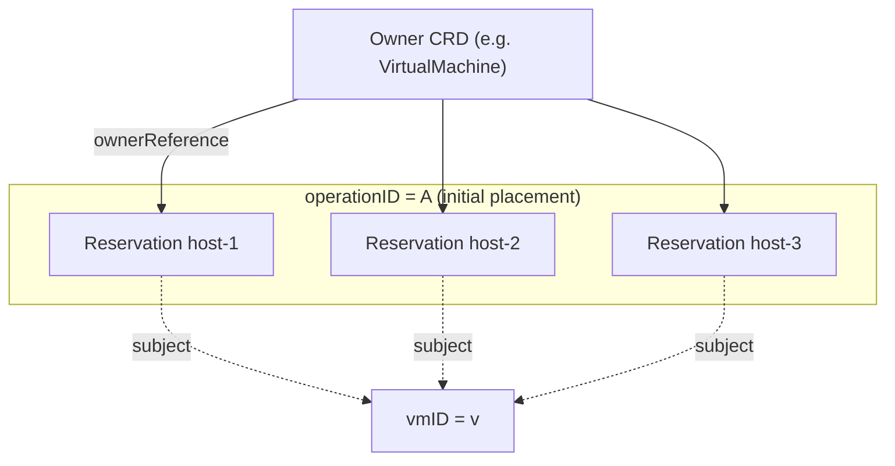
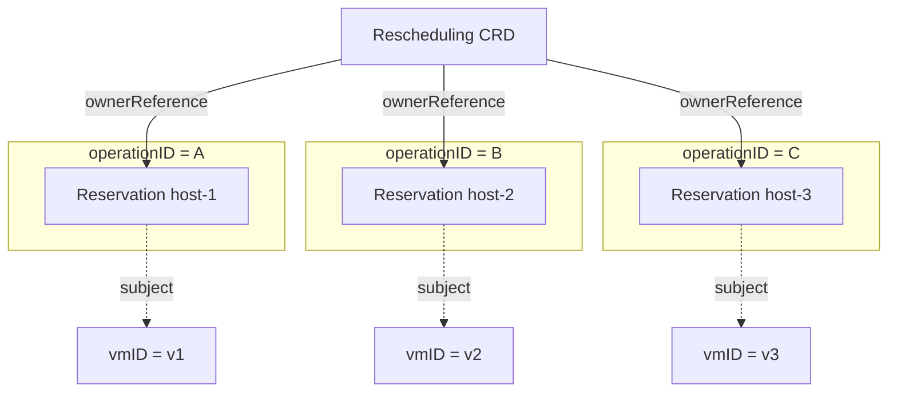
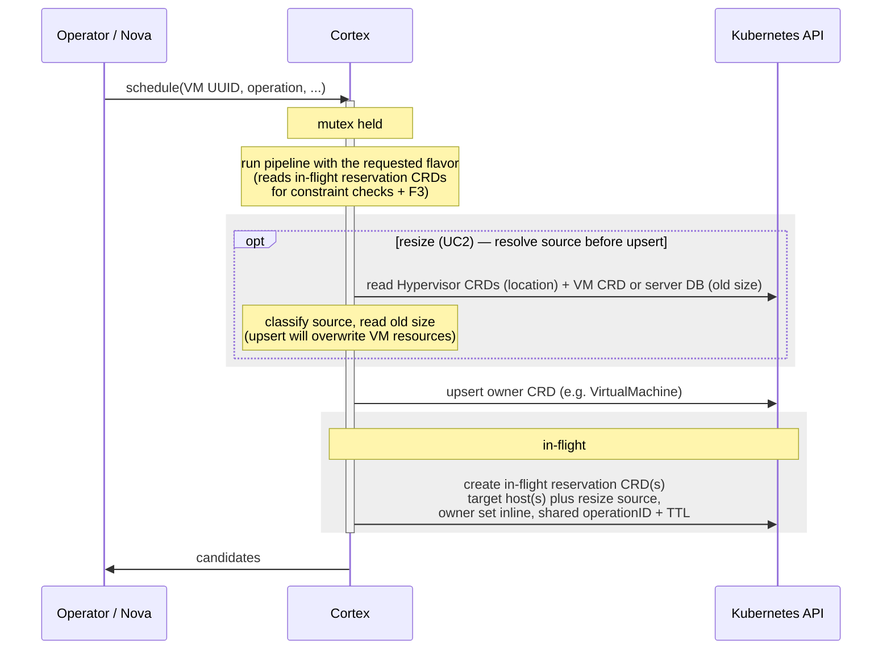
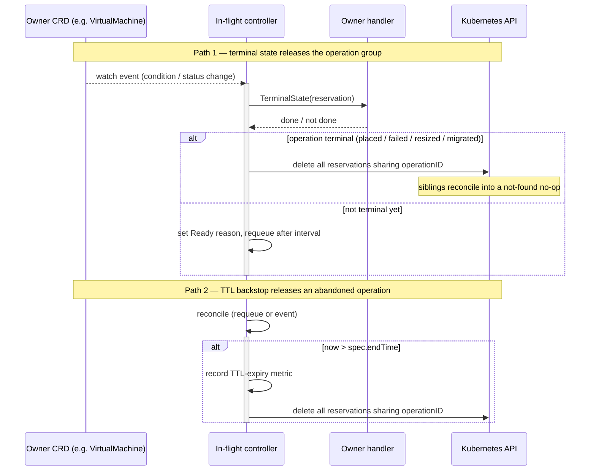
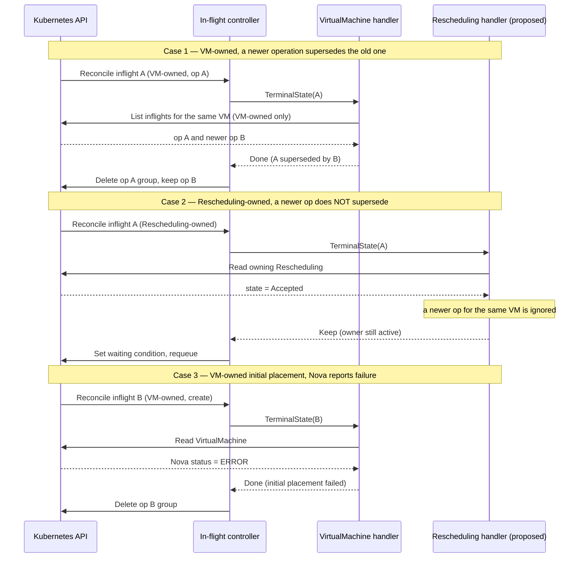

<!--
# SPDX-FileCopyrightText: Copyright SAP SE or an SAP affiliate company and cobaltcore-dev contributors
#
# SPDX-License-Identifier: Apache-2.0
-->

# In-flight reservation controller (implementation)

This page documents the `inflight-reservation-controller` that releases in-flight reservations once the operation they represent is over.
For the concurrency design and why in-flight reservations exist, see [Concurrency and in-flight reservations](04-concurrency-and-in-flight-reservations.md).
The Nova scheduling controller also provides an opt-in producer that writes reservations under the scheduling mutex.
The release controller described here reconciles and releases those reservations.

## Scheduling-Time Creation

Creation is disabled by default through `inFlightReservations: false` in the Nova manager configuration.
When enabled, KVM initial placement creates one reservation per returned candidate (default maximum three), resize returns one candidate and creates target and source reservations, and live migration returns one candidate and creates target and source reservations.
All reservations share a UUIDv7 operation ID and expiry deadline.
Resize creates two holds: a target hold for the requested flavor and, for a KVM source, a source hold for the old size.
The pipeline scores the flavor exactly as Nova sent it; there is no envelope rewrite.
The Hypervisor CRDs are the source of truth for where a VM runs: a VM listed in some Hypervisor `Status.Instances` is a KVM source, otherwise it is unmanaged (e.g. a VMware instance).
The old size comes from the VirtualMachine CRD `Spec.Resources` when the CRD exists; otherwise, if the server-DB fallback is configured, from the Nova server DB.
No Nova API call is made, and the VM CRD or server DB may lag, which is accepted.
A KVM source adds a source hold on the source host; a same-host resize places both holds on that host.
An unmanaged source, or a KVM source whose old size cannot be determined, adds no source hold; the `inFlightResizeUnknownSource` setting (`fail`, the default, or `skip`) decides whether such a resize is rejected or proceeds with only the target hold.
Migration uses Nova's `source_host` hint, with observed VM host as a fallback, and validates source presence in hypervisor inventory.

Final candidate intersection and ordering happen under the same controller-wide mutex as reservation writes and VM upsert.
The VirtualMachine resource is upserted first, then the reservations are created referencing it as owner inline, so a hold is never written without an owner (no orphan window).
The owner reference is attached only when the owner's AZ matches the reservation's AZ, consistent with the resource routers; across AZs the TTL remains the backstop.
Ownership is resolved through a generic owner resolver: the VirtualMachine is the only owner today, but any CRD can own in-flight reservations the same way.
Reservation object names are server-generated from `inflight-<host>-` via `generateName`; the host is also carried in `spec.targetHost` and the operation in `spec.inFlightReservation.operationID`, so the name is an opaque, readable key.
Holds left by a failed call remain conservative blocks until supersession or TTL.
Because Nova serializes operations per VM, the capacity filter ignores in-flight reservations of the requested VM itself: a new request for a VM means its previous holds are obsolete.
Those holds still block other VMs until the release controller removes them.
With creation enabled, evacuation returns a single host (ADR 8, Pattern 3) without creating holds.
Read-only runs, `skip_inflight`, non-KVM requests, internal scheduling intents and empty results do not create holds.
Rebuild, evacuation and host-drain production are outside this implementation.

Configuration requirements when enabling creation:

- `inFlightTTLSeconds` must be positive and cover the permitted operation duration, including resize confirmation; no operation-safe default is assumed.
- `inFlightMaxCandidates` defaults to three when zero and may be configured to another positive initial-placement maximum.
- `virtualMachineCreation` must be enabled; VM upsert failures are mandatory failures for protected requests.
- `forcedDestinationEnabled` must be false so forced requests do not bypass the producer.
- `inFlightResizeUnknownSource` is `fail` or `skip` (default `fail`); it governs resizes whose source size cannot be determined.
- `inFlightResizeServerDBFallback` enables reading a KVM resize's old size from the Nova server DB when the VM has no CRD yet; it requires `inFlightDatasourceName`.
- The write-through cache must include Reservation and VirtualMachine GVKs, as configured in the Nova bundle.
- Use one active scheduling endpoint; the mutex and overlay are process-local, not distributed locks.

Do not enable this gate in production until resize/migration release fallback and abort handling are corrected.
Affinity visibility, CR-slot claims and pending quota admission are separate follow-up work; this producer alone does not establish those guarantees.

### Resize source and target holds

A resize creates two holds: a source hold protecting the old VM footprint on the source, and a target hold for the requested flavor on the target.
The pipeline scores the target against the requested flavor; a same-host resize places both holds on that host.
The source host comes from the Hypervisor CRDs; the old size comes from the VM CRD or, as a fallback, the server DB. No Nova API call is needed.

The considered alternative was a single target hold of the component-wise maximum of the old and requested flavor (an envelope), scored against that maximum.
The two-hold model was chosen because it preserves source rollback capacity explicitly and evaluates the target against the real requested flavor rather than an inflated envelope.
It requires a capacity rule for the overlap between a landed VM and its holds (see [Capacity accounting](#capacity-accounting)) and coordinated release on confirmation or rollback.

## Model

An in-flight reservation is a subtype of the `Reservation` CRD (`spec.type == InFlightReservation`).
Three concepts are kept distinct:

- **Subject** — the workload the reservation is about, identified by `spec.inFlightReservation.vmID`.
- **Owner** — the resource whose lifecycle the reservation is tied to, expressed with native Kubernetes `ownerReferences`. Deleting the owner cascade-deletes the reservation.
- **Operation** — one scheduling call, identified by `spec.inFlightReservation.operationID`. A single operation can create several reservations (one per candidate host, plus the source host for a live migration).

Simplified, showing only the fields this document relies on (see `api/v1alpha1/reservation_types.go` for the full type):

```go
// Owner: metadata.ownerReferences (standard Kubernetes), set by the producer.
type Reservation struct {
    metav1.ObjectMeta // ownerReferences, creationTimestamp, ...
    Spec ReservationSpec
}

type ReservationSpec struct {
    Type                ReservationType // == "InFlightReservation"
    TargetHost          string          // the blocked host
    Resources           map[ResourceName]resource.Quantity
    EndTime             *metav1.Time    // TTL backstop
    InFlightReservation *InFlightReservationSpec
}

type InFlightReservationSpec struct {
    VMID        string          // subject: the VM being placed
    Intent      SchedulingIntent // create | resize | live_migration | ...
    OperationID string          // groups the reservations of one scheduling call
}
```

The **owner** is the standard `metadata.ownerReferences`, not a field in the in-flight spec; **subject** (`VMID`), **operation** (`OperationID`) and release inputs (`Intent`, `EndTime`) live in the spec.

## Assumption: Nova serializes its own operations per VM

The controller relies on one assumption about Nova, agreed with the author of [ADR 8](04-concurrency-and-in-flight-reservations.md):

> Nova holds a per-VM lock on lifecycle operations. When Cortex receives a *Nova* scheduling request for a VM, there is **no other Nova lifecycle operation in flight for that VM** in Nova.

This bounds only requests coming from Nova, and two consequences follow:

- **At most one ongoing *Nova* operation per VM — only for VM-owned holds.**
  The in-flight reservations a Nova request creates are owned by the VM's `VirtualMachine` CRD, and those always belong to a single operation.
  Several reservations may exist within it (one per candidate host, or source + target for a live migration), but they share one operation.
  A later Nova request for the same VM is a *new* operation that starts only after the previous one has ended in Nova; it is not a second concurrent Nova operation.
  This bound does **not** cover reservations owned by other resources: Cortex-internal callers that are not subject to Nova's lock (e.g. the Rescheduler, which owns reservations via a `Rescheduling` CRD) may create in-flight reservations for the same VM concurrently.
  Such reservations live alongside the VM-owned ones and follow their own owner's lifecycle.
- **Observed CRD state may be stale, but Nova is not.**
  Cortex may still *observe* leftover state from a previous Nova operation — reservations not yet garbage-collected, or a `VirtualMachine` condition still carrying a previous operation's terminal reason — because CRD reconciliation is asynchronous.
  The assumption is only that nothing is *ongoing* in Nova, not that every CRD already reflects the latest operation.

This is why terminal detection for VM-owned reservations must distinguish a **fresh** terminal signal (belonging to the current operation) from a **stale** one (left over from a previous operation).
See the VirtualMachine handler below.

For a **VirtualMachine** owner, one operation produces several reservations, all with the same subject (one VM) and the same `operationID`:



For a **Rescheduling** owner (the proposed drain/move owner, see below), a single owner holds the reservations for several moves at once, so it spans multiple VM subjects and multiple `operationID` groups:



## Creating holds: pessimistic blocking under the mutex

The producer creates in-flight reservations inside the scheduling pipeline mutex, in the same critical section as the scheduling response, so any subsequent scheduling call is guaranteed to see them (ADR 8, Pessimistic Blocking Persistence).
The pipeline is scored against the requested flavor unchanged.
For a resize the producer resolves the source before the owner upsert, reading the old size and source host from the VirtualMachine CRD and the Hypervisor CRDs, because the upsert overwrites the VM's `Spec.Resources`.
The owner CRD is then upserted first so the holds reference it inline.



## Capacity accounting

Once a VM lands on a host, that host's `Status.Allocation` already includes it, so counting the VM's in-flight hold again would double-count.
The capacity filter applies a per-(VM, host) rule: if the VM is in that host's `Status.Instances` with `Active=true`, the smallest of that VM's in-flight holds on that host is not counted; all other holds are counted in full.
This keeps a resize's larger target hold effective while dropping the already-counted source footprint, and it also covers create and live migration.
The rule lives only in the capacity filter.
The shared free-capacity helpers (`HostHasCapacityForReservation`, `HostFreeCapacity`) currently ignore in-flight reservations entirely (a TODO), so failover and committed-resource placement may pick a host that an in-flight hold is blocking.
The oversubscription controller and the reserved-capacity reporter never iterate in-flight holds, so they are unaffected.

| Case | Counted on host |
|---|---|
| Resize to another host, source | source hold skipped once the VM is active there; counted while it is not |
| Resize to another host, target | target hold counted in full |
| Same host, VM running | smaller of target and source skipped, the larger counted |
| Same host, VM shut off | both holds counted (VM not active in the host inventory) |
| After landing on target | target hold skipped (VM now active on the target) |
| Source after landing | source hold skipped while the VM is still active on the source |
| Create, landed | the single hold skipped (VM now active on the host) |

## API

In-flight specific fields on `Reservation.spec.inFlightReservation`:

| Field | Meaning |
|---|---|
| `vmID` | Subject VM uuid. Distinct from the owner; generalized when a non-Nova subject appears. |
| `intent` | Operation kind (`create`, `resize`, `live_migration`, ...). Selects the terminal condition. |
| `operationID` | UUIDv7 grouping all reservations of one scheduling call. Set by the producer. |

Lifecycle is controlled by generic fields: `spec.targetHost`, `spec.endTime` (TTL), and `metadata.ownerReferences`.

Owner-kind-specific behaviour is encapsulated in an `OwnerHandler`.
The controller owns watch wiring, `operationID` grouping, TTL and deletion; a handler only declares what to watch and decides when one reservation's operation is over.

```go
type OwnerHandler interface {
    Kind() string                 // owner-reference Kind, e.g. "VirtualMachine"
    WatchObjects() []WatchSpec     // secondary resources + event -> reservation mapping
    TerminalState(ctx, res) (TerminalResult, error)
}
```

### Reconcile flow

Secondary resources (the owner's CRD, the Hypervisor CRD) are watched so their changes re-reconcile the affected reservations.
Release is scoped to `operationID`, so completing one operation never releases reservations of a different concurrent operation on the same VM.

The two release paths — a terminal signal from the owner CRD, and the TTL backstop — both end in the same operation-group deletion:



TTL is evaluated first on every reconcile, before owner dispatch, so an abandoned operation is released even when no owner handler or terminal signal ever arrives.

### Owner dispatch cases

The following sequence shows three cases across both owner kinds, assuming the TTL has not expired:



### VirtualMachine handler

For the VM owner, terminal detection reads the `VirtualMachine` CRD, dispatching on `intent`:

| Intent | Watched condition | Released when |
|---|---|---|
| `create` | `Status.Host`, `Running`, `Nova.Status` | placed and live (`Running=True` or Nova `ACTIVE`), or failed (Nova `ERROR`) |
| `resize` (KVM source) | `Resizing` | reason `Completed`, `Reverted`, or `Failed`, **and the condition transitioned at/after the reservation was created** |
| `resize` (unmanaged source) | `Status.Host`, `Running`, `Nova.Status` | placed and live on the target; never released on failure (TTL backstops a failed resize) |
| `live_migration` | `Migrating` | reason `Completed`, `RolledBack`, `Aborting`, or `Failed`, **and the condition transitioned at/after the reservation was created** |

**Unmanaged-source resize.**
A resize whose source is not KVM-managed (e.g. a VMware instance) has no KVM source hold, so the vm-operator never writes a `Resizing` condition for it.
The producer marks such holds with the label `reservations.cortex.cloud/inflight-source=unmanaged`, and the handler releases them on landing plus alive, exactly like initial placement, but never on failure.
The label lives only on the short-lived in-flight reservation and disappears when the reservation is released.

**Fresh vs. stale terminal conditions.**
Because Nova serializes operations per VM (see the assumption above), when Cortex creates a new operation's holds the VM CRD may still carry a terminal `Resizing`/`Migrating` reason from a *previous* operation.
Releasing on that would delete the fresh holds immediately.
The handler therefore trusts a terminal reason only when the condition's `LastTransitionTime` is at or after the reservation's `metadata.creationTimestamp`, i.e. the condition transitioned *after* this operation's holds were created.
A condition with no transition time, or one that transitioned earlier, is treated as stale: the handler keeps waiting for the current operation's transition, with the TTL backstop guarding against a signal that never comes.

If several operations exist for one VM, only the newest wins: older operations are released, ordered by `(creationTimestamp, operationID)`.

**Hypervisor landing fallback (initial placement only).**
When the VM CRD or its condition is not yet available, the handler falls back to the Hypervisor CRD landing signal, but this is terminal **only for `create`**.
For initial placement the VM had no prior host, so observing it on any hypervisor means the placement landed and the operation is done.
For every other intent the fallback is *not* a completion signal and the handler keeps waiting for the TTL backstop instead: a `resize` keeps the VM on its host throughout, and a `live_migration` holds the source and target while the VM still sits on the source, so observing it on a hypervisor says nothing about whether the operation finished.
Without a decisive VM-CRD condition, resize and live-migration holds are released only by their `Resizing`/`Migrating` terminal condition or, failing that, the TTL.

### Proposed Rescheduling handler

The following is a proposal, not yet implemented.
A second owner kind is foreseen: the `Rescheduling` CRD (a drain/move request executed by the Rescheduler).
Unlike the VirtualMachine handler, a single `Rescheduling` owns the reservations for several moves at once, so it spans **multiple VM subjects and multiple `operationID` groups** under one owner.

Its lifecycle is driven solely by the owner's `status.state`:

| `Rescheduling` state | In-flight reservations |
|---|---|
| `Processing`, `Accepted` | kept |
| any other state (`Pending`, `Acknowledged`, `Rejected`, `Succeeded`, `Failed`) | released |
| owner deleted | released by Kubernetes garbage collection via `ownerReference` |

This is deliberately coarse: reservations are held for the whole request, not released per-move as each VM lands.
The VM-specific logic (per-intent terminal conditions, newest-wins supersession, Hypervisor landing fallback) does **not** apply to `Rescheduling`-owned reservations, including when both owner kinds hold reservations for the same VM.

### Metrics

- `cortex_inflight_reservation_ttl_expired_total{intent}` — reservations released by the TTL backstop.
- `cortex_inflight_reservation_anomaly_total{reason}` — alertable anomalies (`no_owner_handler`, `ambiguous_owner`); inspect controller logs for detail.

## Open points (TODO)

- **Host spec vs. status.** Terminal detection should compare the VM's desired host (`spec.targetHost`) against its observed host (`status.host`), not just whether a host is set, so a reservation is released only once the observed placement matches what was scheduled.
- **Blocking relies on `status.host` being set in time.** Blocking itself is already immediate: reservations are written under the scheduling mutex through the write-through cache, so a new hold is visible to the next scheduling request. The open point is reconciliation: terminal detection and the capacity filter read the VM's observed `status.host`, which the platform populates asynchronously. Until it is set, the controller cannot confirm the placement landed and cannot reconcile the hold against the VM's own allocation.
- **Generic ready signal.** A reservation-level `Ready` condition should be defined generically so reservations can be consumed uniformly (blocking, reporting) regardless of type, rather than each consumer special-casing in-flight vs. committed vs. failover state.

## Limitations

- Only the `VirtualMachine` owner handler is implemented. A `Rescheduling` handler is proposed (see above) but not yet present; the registry is extensible.
- Terminal VM conditions are matched by `intent`, not correlated to an `operationID`. Relying on the Nova per-VM operation lock (see the assumption above), the handler instead uses the condition's `LastTransitionTime` as a freshness check: a terminal reason that transitioned before the reservation was created is treated as a previous operation's leftover and does not release the holds. This bounds the stale-condition hazard; a terminal reason without a transition time falls through to the TTL backstop.
- For `create`, `Scheduled=False` is not used as a failure signal: it is not written on failure today and reflects the VM's latest scheduling result rather than this operation. Failed initial placements are released by Nova `ERROR` or the TTL backstop.
- The hypervisor landing fallback (used when no VM CRD condition is available) concludes terminal only for `create`. Resize and live-migration holds have no landing-based release path, so if their `VirtualMachine` condition never arrives they are held until the TTL backstop. This is deliberate: hypervisor observation cannot distinguish a completed resize/migration from one still in progress on the same host.
- Without an `operationID`, grouping and supersession are disabled and only the single reservation is released. Without `spec.endTime`, there is no TTL backstop.
- The TTL is evaluated during reconciliation (on events or requeue), not by a dedicated deadline timer, so release can lag the exact expiry time.
- Newest-wins supersession is specific to the VirtualMachine handler and does not apply to other owner kinds.
- A resize's old size comes from the VirtualMachine CRD, or the Nova server DB when the fallback is enabled and the CRD is absent; both can lag Nova, yielding a conservatively sized source hold.
- A same-host downsize holds both the old and the new size while the VM is running, which is conservative until the resize confirms.
- `inFlightResizeUnknownSource` governs resizes whose source size cannot be determined: `fail` (default) rejects them, `skip` proceeds with only the target hold.
- The shared free-capacity helpers ignore in-flight reservations (a TODO), so failover and committed-resource placement may select a host an in-flight hold is blocking; the capacity filter itself does account for in-flight holds.
- Under the proposed `Rescheduling` handler, a VM may be moved again before the request finishes, leaving a stale hold on its previous target host. This is expected to be rare and is cleared by the owner-state cleanup or the TTL backstop.


## Next

[Prev: Concurrency and in-flight reservations](04-concurrency-and-in-flight-reservations.md) · [Next: The Placement API shim »](05-placement-api-shim.md)
